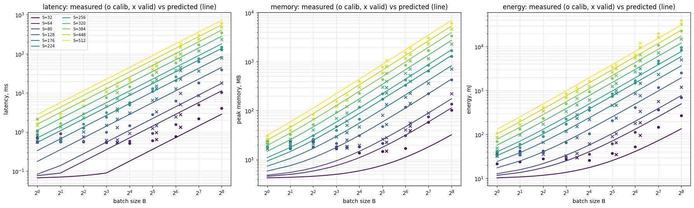

# HW1

## Окружение

- GPU: Tesla T4 из google colab
- PyTorch: 2.11.0+cu128

## Коммент по модели

bias выключен **везде**, batchnorm отсутствует

## Как воспроизвести

Открыть measure_notebook.ipynb в Colab (runtime T4) и прогнать все ячейки

**ИЛИ**

В отдельные файлы скопировал разную логику, как и требовалось. Можно завести вот так:

```bash
pip install torch numpy pandas scipy matplotlib pynvml
python measure.py      # -> results/measurements.csv
python calibrate.py    # -> results/theta.json
python plots.py        # -> results/figures/predicted_vs_measured.png
```

Валидация: S = [80, 176, 320, 448], B = [11, 36, 74]



## Короткие выводы

Latency. При малых нагрузках время почти постоянно, тк оно определяется не количеством работы, а запуском ядер, формула недооценивает это. Чем больше работа, тем лучше сходится посчитанное и предсказанное значение, тк latency все больше зависит от объема работы а не от констант.

Память. 
При малых нагрузках измерено 17–24 MB против предсказанных ~4 MB: постоянную добавку дают
workspace cuDNN и аллокатор. При увеличении размера изображения и батча предсказанное значение все лучше начинает сходиться с посчитанным. Это вызвано тем, что постоянные затраты занимают все меньшую долю, на передний план выходит работа, которая пропорциональна батчу и размеру изображения.
В сетке OOM не получилось достичь. Вне сетки при B = 256 формула
предсказывает OOM с S = 752, а реально он наступает между S = 896 и S = 1024. Такая погрешность вызвана тем что подсчет memory через сумму является достаточно грубым подходом, поэтому мы предсказываем ООМ раньше, чем он в итоге происходит.
Более детальный вывод показан в конце measure_notebook.ipynb

Энергия. Мощность почти постоянна, 60–70 Ватт во всех конфигурациях, поэтому E ≈ 65 × latency.

В целом формулы корректно описывают масштабируемую часть затрат, но плохо описывают константы, которые и дают значительное расхождение на графиках при небольшом объеме работы.